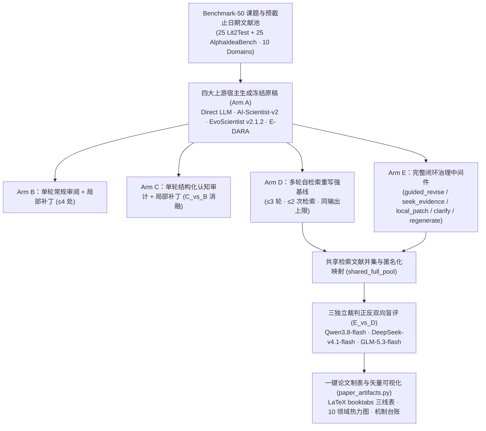

# 系统架构说明（Architecture）

`edara-external-eval` 包含两个紧密协同的核心子系统：

1. **宿主无关的可信与组合新颖性治理中间件（Trustworthy & Compositional Novelty Middleware）**：无需侵入上游科研 Agent 内部状态，对任意 JSON 研究提案进行句子级证据核查、外部未核验实体剥离、假设特异同源混杂对照臂诊断、统计功效校准与 Schema 无损修订。
2. **同稿五臂对称对照与三评委盲评套件（Benchmark-50 Unified Evaluation Suite）**：在固定 10 大领域 × 50 道课题上，对同一份冻结原稿派生对称预算对照臂，由三位事前校准的独立盲评模型进行正反双向去偏评审。

---

## 1. 端到端数据流与同稿五臂协议

---

## 2. 模块分层职责

### 2.1 公共接入与跨宿主适配层

| 模块 | 职责 |
| :--- | :--- |
| `plugin.py` | 宿主无关 Python API 入口 `govern_proposal()`，支持一行代码接入任意自定义 JSON 提案字典。 |
| `cli.py` | `edara-mvp` 命令行入口（`govern` 单稿治理、基准任务准备与离线干跑校验）。 |
| `host_adapter.py` | 跨宿主字段语义角色识别（自动适配 `Direct`、`AI-Scientist-v2`、`EvoScientist`、`E-DARA` 的异构键名）、原生字段 100% 保留护栏、文献锚点与对照设计防丢失校验。 |
| `schemas.py` | 全仓统一 Pydantic 数据契约：课题规范、文献条目、认知审计包、混杂诊断与费用计量记录。 |

### 2.2 认识论与实验设计审计层

| 模块 | 职责 |
| :--- | :--- |
| `epistemic_audit.py` | 综合审计主入口 `run_full_audit`：协调三态认识论核查、文献缺口反例检验、规格完整性与组合新颖性审计。 |
| `factual_audit.py` | 句子级事实归因核查、未入库外部幻觉实体检测（`audit_unverified_entities`）、跨字段定量阈值冲突检查及虚假流程词清理。 |
| `confound_audit.py` | 假设特异混杂变量审计：识别能产生同等预期现象的同源替代解释，并生成最小可判别对照臂（`discriminating_control`）。 |
| `claimnov_adapter.py` | 组合新颖度（`ClaimNov`）提取与比对适配，内置离线 BM25 回退。 |
| `governance.py` | 核心主张与组件级文献覆盖度判定及预截止日期准入规则（`admissible`）。 |

### 2.3 有界闭环路由与同稿评测层

| 模块 | 职责 |
| :--- | :--- |
| `feedback.py` | 五动作有界状态机（`guided_revise`、`seek_evidence`、`local_patch`、`clarify`、`regenerate`）及修补后一致性合并触发器。 |
| `middleware.py` | 审计诊断组装（`_build_diag`）与多轮证据反馈执行器。 |
| `paired_trial.py` | 同稿五臂（`A/B/C/D/E`）受控预算试验引擎、核心数学机制保护、统计功效匹配与逐请求计量客户端 `TrialRunner`。 |
| `unified_eval.py` | 三轴统一盲评器：`Lit2Test` 正反序折叠五维对比、`AlphaIdeaBench` 5 维量表与 `ClaimNov` 组合新颖度差值。 |
| `tasks_loader.py` | 跨 10 领域对称 **Benchmark-50** 加载器及防泄漏文献边界导出。 |
| `paper_artifacts.py` | 跨波次结果去重聚合、10,000 次题目加权 Bootstrap 置信区间计算、LaTeX `booktabs` 三线表与 SVG 矢量图生成。 |

---

## 3. 核心实验公平性不变量

1. **原稿哈希锁定**：所有对比臂（`B/C/D/E`）严格从同一份 SHA-256 校验通过的宿主原稿 `Arm A` 出发。
2. **模型与资源对称**：`Arm D`（强基线）与 `Arm E`（治理中间件）锁死同一编辑器底座、同一温度、同一 `thinking` 开关、同一最大轮数（`≤3`）、同一文献检索上限（`≤2`）与单次输出上限（`4096` tokens）。
3. **证据池对称盲评**：盲评 `E_vs_D` 时统一合并 `D` 与 `E` 检索到的文献并集（`shared_full_pool`），统一重映射匿名引用编号 `[Sxxxx]`，评委不可见臂别标识与修订轨迹。
4. **双向换序消偏**：每对比较均执行 `forward (D vs E)` 与 `reverse (E vs D)`；凡正反序结论不一致（`order_sensitive`）一律保守折算为平局（`tie`）。
5. **角色独立与多裁判交叉**：主裁判 `Qwen3.8-flash` 与生成/编辑（`DeepSeek-v4.1-flash`）、内部审计（`GLM-5.3-flash`）完全跨模型家族隔离，并同步报告三评委多数投票（`3-Judge Majority Vote`）。
