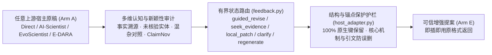

# E-DARA Trustworthy & Novelty Middleware (`edara-external-eval`)

<p align="left">
  
  
  
  
  
</p>

**`edara-external-eval`** 是从主框架 [`xixi501/edara`](https://github.com/xixi501/edara) 提炼出的**零侵入、跨宿主通用的科研提案认知治理外挂与统一盲评基准（Trustworthy & Compositional Novelty Middleware）**。

它无需修改上游科研生成 Agent 的内部状态，即可直接挂载在 **`Direct LLM`、`AI-Scientist-v2`、`EvoScientist`、`E-DARA`** 或任意自定义 JSON 提案生成器之后：自动拦截未核验外部幻觉实体与虚假流程包装词、补齐排除替代解释的同源判别对照臂、在不破坏原宿主 Schema 的前提下完成多字段协同修订，并提供 **Lit2Test（五维双向位置去偏盲评）+ AlphaIdeaBench + ClaimNov（组合新颖性）** 三轴统一评测。

---

## 工作流概览



---

## 30 秒即插即用（Standalone Quickstart）

本包内置零外部仓库依赖离线回退，克隆后无需安装非 PyPI 私有包即可直接运行治理 API、CLI 与全套 130 项单元测试：

```bash
git clone https://github.com/xixi501/edara-external-eval.git
cd edara-external-eval
pip install -e .
pytest -q   # 130 passed
```

### 1. Python 一行挂载 (`govern_proposal`)

```python
from edara_mvp_eval import govern_proposal

outcome = govern_proposal(
    draft={
        "title": "Adaptive KV Eviction for Long-Context Reasoning",
        "literature_gap": "Existing methods never consider step-level attention drift.",
        "hypothesis": "Entropy-guided eviction improves reasoning accuracy.",
        "method": "Evict low-entropy heads dynamically during decoding.",
        "minimal_test": "Compare against H2O on GSM8K-Long.",
        "decisive_metric": "Exact-match accuracy at 25% KV budget.",
    },
    task_title="KV-Cache Compression for Long-Context LLMs",
    prior_work=[{"id": "P1", "title": "H2O: Heavy-Hitter Oracle", "year": "2023", "abstract": "..."}],
    editor_profile="configs/dashscope-deepseek-profile.json",
    audit_profile="configs/p1b-critic-profile.json",
)
print(outcome.status, outcome.rounds, list(outcome.draft.keys()))
```

### 2. CLI 命令行治理单份提案 (`edara-mvp govern`)

```bash
# 离线冒烟验证（无需任何 API Key）
PYTHONPATH=src python -m edara_mvp_eval.cli govern --input proposal.json --output governed.json --dry-run

# 真实模型闭环治理
PYTHONPATH=src python -m edara_mvp_eval.cli govern \
  --input proposal.json \
  --output governed.json \
  --editor-profile configs/dashscope-deepseek-profile.json \
  --audit-profile configs/p1b-critic-profile.json
```

---

## 核心模块说明

| 模块 | 职责 |
| :--- | :--- |
| `plugin.py` & `cli.py` | 宿主无关公共入口（`govern_proposal()` 与 `edara-mvp govern`），原样保留宿主字段命名与嵌套结构 |
| `host_adapter.py` | 跨宿主语义角色映射（兼容 `Direct`、`AI-Scientist-v2`、`EvoScientist`、`E-DARA`）、文献锚点与对照元素保留护栏 |
| `factual_audit.py` & `confound_audit.py` | 句子级事实归因核查、外部未入库命名实体扫描、跨字段阈值一致性校验与假设特异同源混杂对照臂诊断 |
| `feedback.py` & `paired_trial.py` | 五动作有界治理循环（`guided_revise`、`seek_evidence`、`local_patch`、`clarify`、`regenerate`）及同稿五臂对照试验引擎（`A/B/C/D/E`） |
| `unified_eval.py` & `claimnov_adapter.py` | `Lit2Test` 正反序折叠五维盲评、`AlphaIdeaBench` 结构评分与 `ClaimNov` 组合新颖度评估 |
| `tasks_loader.py` & `pilots/` | 跨 10 领域对称 **Benchmark-50**（`25 Lit2Test + 25 AlphaIdeaBench`）加载器与多宿主分波次运行脚本（`run_benchmark50_wave.py`、`run_evoscientist_wave.py`） |

---

## 已归档实证评测结果摘要（同预算强基线 `E_vs_D` 三评委交叉盲评）

> 注：`Arm D` 为**相同检索上限与相同多轮重写预算**的通用 LLM 自审自修强基线，`E_vs_D` 严格隔离“单纯多花 Token 重写”带来的表面收益。

- **30 题 `N=68` 跨评委汇总**（[`results/extension_15_20261120_qwen3/crossjudge_3way_ext15_and_combined68.md`](results/extension_15_20261120_qwen3/crossjudge_3way_ext15_and_combined68.md)）：
  - **三独立裁判多数决（`Qwen3.8-flash` / `DeepSeek-v4.1-flash` / `GLM-5.3-flash`）**：**`38 胜 / 17 负 / 13 平`**，题目加权净胜率 **`+0.283`**（`95% CI [+0.067, +0.483]`），五维总分差 **`+0.938`**（`95% CI [+0.157, +1.636]`）；三个独立评委各自全部显著为正（Qwen `+0.322`、GLM `+0.294`、DeepSeek `+0.244`）。
  - **客观确定性机制台账（`N=68`）**（[`results/extension_15_20261120_qwen3/mechanism_audit_stats_combined68.json`](results/extension_15_20261120_qwen3/mechanism_audit_stats_combined68.json)）：
    - 虚假流程包装词（如无据宣称 `pre-registered` / `already validated`）：从 `D: 17 稿 32 处` 压降至 **`E: 0 稿 0 处`（`-100%`）**；
    - 未核验外部幻觉实体：从 `D: 367 处` 压降至 **`E: 169 处`（`-54.0%`）**；
    - 原宿主 JSON 字段保留率：**`68 / 68`（`100%`）**，混杂判别臂准确落入实验设计字段率 **`94.7%`**。
- **Unified `v4` 核心队列（`N=38`）**（[`results/unified_pilot_20261119_v4/core_summary.md`](results/unified_pilot_20261119_v4/core_summary.md)）：`E_vs_D` **`25 胜 / 7 负 / 6 平`**（净胜率 **`+0.489`**，总分差 **`+1.383`**）；其中 `AI-Scientist` 宿主 **`13 胜 / 1 负 / 0 平`（`+0.857`）**，`E-DARA` 宿主 **`7 胜 / 1 负 / 1 平`（`+0.667`）**。
- **固定 50 题跨 10 领域主基准规范**：详见 [`docs/BENCHMARK_50_TOPICS.md`](docs/BENCHMARK_50_TOPICS.md)，最新分波次跨宿主（含 `AI-Scientist-v2` 与 `EvoScientist v2.1.2`）自动汇总图表见 [`results/paper_ready/PAPER_SUMMARY_REPORT.md`](results/paper_ready/PAPER_SUMMARY_REPORT.md)。

### 一键导出论文 LaTeX 三线表与矢量图

完成任意波次评测后，运行以下命令即可零成本离线合并所有已完成波次与四大宿主，生成 `booktabs` LaTeX 表格（`.tex`）与高清 SVG 矢量图：

```bash
python pilots/generate_paper_artifacts.py --results-dir results --out-dir results/paper_ready
```

---

## 仓库目录结构

```text
edara-external-eval/
├── src/edara_mvp_eval/  # 治理外挂核心引擎、跨宿主适配器、CLI 与三轴评测器
├── pilots/              # Benchmark-50 分波次运行器、EvoScientist 多智能体宿主运行器与验证脚本
├── configs/             # 模型端点配置模板（仅声明环境变量名，零明文密钥）
├── data/                # 冻结 Benchmark-50 题目规范、种子文献快照与裁判校准集
├── docs/                # 50 题分层设计文档、评测协议规范 (v1.2) 与证据映射说明
├── results/             # 历次多裁判盲评总表、校准记录与确定性机制审计台账
└── tests/               # 130 项零外部依赖离线单元测试
```
