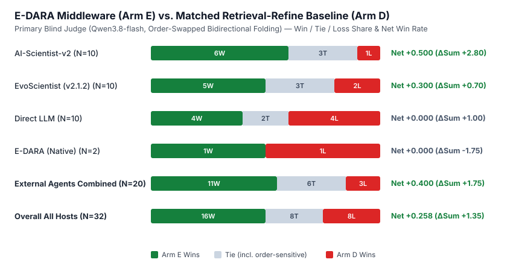
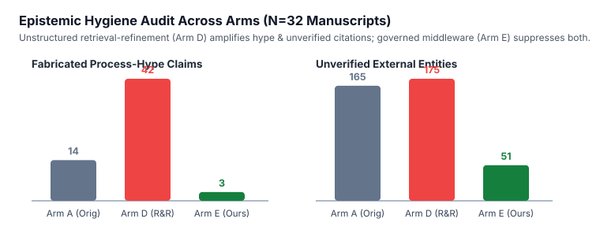
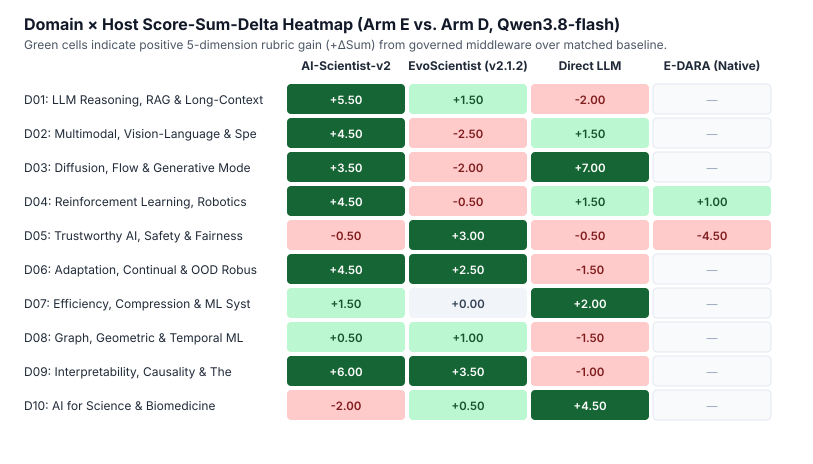
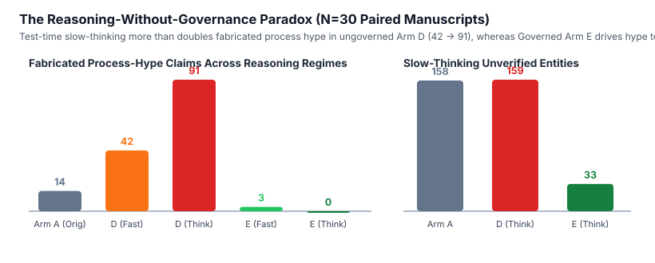

# 跨宿主可插拔科研认知治理外挂（E-DARA Middleware）实验总结汇报

**汇报日期**：2026-11-22  
**开源仓库**：评测与治理中间件仓 `xixi501/edara-external-eval`（`main` @ `11a5187`）｜核心系统仓 `xixi501/edara`（`main` @ `8b39048`）

> **一页纸核心摘要（Executive Summary）**
> - **核心研究问题**：当前主流自动科研系统（如 `AI-Scientist-v2`、`EvoScientist` 及原生大模型生成）以及常规“多轮检索+自反思（Retrieve-and-Revise）”在处理真实科研课题时，普遍存在三类严重认识论缺陷：**① 捏造未执行的实验背书**（如无中生有声称已预注册 `pre-registered`）；**② 引入文献包外未核验的外部实体/基线/数值幻觉**；**③ 遗漏关键的混杂变量鉴别控制组（Confounding Control）或设定与样本量功效不匹配的统计判据**。
> - **方法定位**：我们构建了一套**宿主无关、模型无关的可插拔认知治理中间件（Host-Agnostic Epistemic Governance Middleware）**。它无需侵入修改上游科研智能体源码、100% 保持各宿主原生 JSON Schema，通过 **“结构化四维认知审计 → 受控文献检索与分级修订（`guided_revise` / `clarify` / `local_patch`）→ 阻断性混杂控制与防退化硬门禁 → 终态连贯性整合”** 闭环提升提案的科学严密性与可证伪性。
> - **实验总规模与成本**：累计完成 **`162` 组同稿受控配对多臂试验**（主基准 `94` 篇 + `v0.2` 诊断面板 `8` 篇 + 跨模型家族泛化 `30` 篇 + 慢思考消融 `30` 篇，另含 `10` 篇慢思考直出探针），执行逾 **`900` 次双向位置交换盲评调用**，实测累计 API 总开销约 **`$25.2`**（单篇完整闭环 + 三评委盲评均摊仅约 **`$0.15–$0.18`**）。

---

## 一、 实验部分是如何一步步展开的？（五阶段递进脉络）

1. **阶段一：建立防作弊评测协议与评委校准门禁（Calibration Gate）**
   - 在正式实验前构建独立合成扰动校准集：对真实提案注入“事实失真（Grounding）”、“判据模糊（Decisive Metric）”、“不可证伪（Falsifiability）”三类实质缺陷（12 例）及纯同义句式改写（Sham Paraphrases，4 例）。盲评器通过 **实质缺陷检出 `11/12`、同义改写判平 `3/4–4/4`** 门禁后冻结全部盲评 Rubric。
2. **阶段二：跨宿主、跨领域主基准评测（`Benchmark-50` 之 `Wave 1 + Wave 2`，`N=94`）**
   - 在覆盖 AI/CS **10 大子领域**、兼顾 **`Lit2Test`** 与 **`AlphaIdeaBench`** 双赛道的 `30` 道独立题目上，测试 3 种代表性外部宿主范式（`Direct LLM`、`AI-Scientist-v2`、`EvoScientist v2.1.2`）及 `4` 篇历史原生 `E-DARA` 提案，使用 3 个异构家族评委双向位置交换盲评。
3. **阶段三：负例根因诊断与中间件 `v0.2` 机制精修（`N=8` 平衡面板验证）**
   - 复盘负例定位出“测试床名称误擦除”、“检索后局部补丁碎片化”、“小样本统计检验功效错配”三类问题，完成通用代码修复并在 `4` 负例 + `4` 胜例平衡面板上验证（多数决从 `4W/4L/0T, -0.08` 提升至 `4W/2L/2T, +0.83`，4 篇胜例零退化）。
4. **阶段四（动作 A）：跨模型家族泛化实验（`Qwen3.8-flash` 基座，`N=30`）**
   - 将宿主生成与多轮编辑整体替换为 **`Qwen3.8-flash`**，并将盲评主裁判**镜像反转**为完全异源的 **`DeepSeek-v4.1-flash` + `GLM-5.3-flash`**，排除单一模型或同家族自偏好偏差。
5. **阶段五（动作 B）：慢思考推理（`Slow-Thinking`）+ `8192` 输出窗口 2×2 受控消融（`N=30` + `10` 探针）**
   - 100% 复用 `Wave 1` 冻结原稿，对称开启 `thinking: enabled` 与 `8192` 正文输出上限，验证推理模型时代治理外挂是否依然必需。

---

## 二、 受控实验设计与公平性保障

| 实验臂 | 名称与机制定义 | 允许检索次数 | 最大迭代轮数 | 关键公平性设计 |
| :--- | :--- | :---: | :---: | :--- |
| **`Arm A`** | **上游宿主原生提案**（`Direct` / `AI-Scientist-v2` / `EvoScientist` / `E-DARA`） | 宿主自带（受 `cutoff_date` 截断） | — | 严格按题目发表截止日期过滤 OpenAlex 文献，屏蔽目标未来论文标题哈希，杜绝时间穿越泄漏。 |
| **`Arm B`** | **单轮无治理局部补丁基线**（通用审稿提示 + 最多 4 处锚点修改） | `0` | `1` | 与 `Arm C` 共享完全相同的初始文献包与局部编辑配额。 |
| **`Arm C`** | **单轮认知治理补丁消融臂**（结构化认知审计 + 单轮局部补丁） | `0` | `1` | 剥离“单轮局部修补”与“多轮检索闭环治理”的贡献。 |
| **`Arm D`** | **同预算多轮检索自反思强基线（Retrieve-and-Revise）** | **`<= 2` 次** | **`<= 3` 轮** | 拥有与 `Arm E` **完全相同**的编辑模型、输出 token 上限、文献检索工具和轮数预算，仅无治理协议。 |
| **`Arm E`** | **可插拔认知治理外挂（Ours: Governed Middleware）** | **`<= 2` 次** | **`<= 3` 轮**（含检索后收口整合） | 结构化四维审计 + 阻断性混杂控制强制门禁 + 防退化护栏。 |

- **三评委双向盲评机制**：`Arm E` vs. `Arm D` 共享 `D ∪ E` 合并证据池（`shared_full_pool`），由 `Qwen3.8-flash`、`DeepSeek-v4.1-flash`、`GLM-5.3-flash` 分别执行 `forward + reverse` 双向位置交换盲评（顺序敏感判平 `tie`）。

---

## 三、 四大实验模块结果详表

### 1. 主基准跨宿主评测（`Wave 1 + Wave 2`，`30` 题 × `10` 领域，`N=94` 篇）

| 上游宿主系统 | 样本数 $N$ | 独立主评委 (`Qwen3.8`) W/L/T | `Qwen` 净胜率 (`95% CI`) | `Qwen` 五维总分差 `ΔSum` (`95% CI`) | `DeepSeek` 净胜率 | `GLM` 净胜率 | **三评委多数决 W/L/T (`Net`, `ΔSum`)** |
| :--- | ---: | :---: | :---: | :---: | :---: | :---: | :---: |
| **`AI-Scientist-v2`** | 30 | `18 / 6 / 6` | **`+0.400`** (`[+0.10, +0.67]`) | **`+1.85`** (`[+0.88, +2.80]`) | `+0.233` | `+0.500` | **`17 / 6 / 7`** (`+0.367`, `+1.59`) |
| **`EvoScientist (v2.1.2)`** | 30 | `12 / 8 / 10` | **`+0.133`** (`[-0.17, +0.43]`) | **`+0.72`** (`[+0.02, +1.42]`) | `-0.200` | `+0.000` | **`9 / 9 / 12`** (`+0.000`, `-0.03`) |
| **`Direct LLM`** | 30 | `11 / 9 / 10` | **`+0.067`** (`[-0.23, +0.37]`) | **`+0.70`** (`[-0.12, +1.53]`) | `-0.033` | `-0.033` | **`10 / 11 / 9`** (`-0.033`, `+0.01`) |
| **`E-DARA`（历史小样本）** | 4 | `2 / 1 / 1` | **`+0.250`** (`[-0.50, +1.00]`) | `-0.12` (`[-3.12, +2.00]`) | `+0.000` | `+0.250` | **`2 / 1 / 1`** (`+0.250`, `+0.08`) |
| **外部科研智能体合计 (`AI-Sci + EvoSci`)** | **60** | **`30 / 14 / 16`** | **`+0.267` (`[+0.02, +0.50]`)** | **`+1.28` (`[+0.58, +1.95]`)** | `+0.017` | `+0.250` | **`26 / 15 / 19` (`+0.183`, `+0.78`)** |
| **全样本总计 (`Overall`)** | **94** | **`43 / 24 / 27`** | **`+0.206` (`[+0.03, +0.37]`)** | **`+1.06` (`[+0.59, +1.52]`)** | `0.000` | `+0.158` | **`38 / 27 / 29` (`+0.119`, `+0.51`)** |

| 确定性审计指标（代码级规则核验，`N=94`） | `Arm A`（宿主原稿） | `Arm D`（无治理多轮自反思） | **`Arm E`（治理中间件）** | `E` 相对 `D` 净改善 |
| :--- | :---: | :---: | :---: | :---: |
| **原生宿主 Schema 字段保留率** | `94 / 94` | — | **`94 / 94` (`100.0%`)** | **零结构破坏，即插即用** |
| **捏造未执行流程背书词频**（如 `pre-registered`） | `59` 次 | `187` 次（**恶化 `3.17×`**） | **`9` 次** | **`-95.2%`** |
| **文献包外未核验外部实体幻觉总数** | `470` 个 | `476` 个 | **`144` 个** | **`-69.7%`** |
| **阻断性实验混杂控制（Blocking Confounds）解决率** | `21 / 51` (`41.2%`) | `27 / 51` (`52.9%`) | **`48 / 51` (`94.1%`)** | **`+41.2` 个百分点** |

---

### 2. 动作 A：跨模型家族泛化实验（`Qwen3.8-flash` 驱动生成+修订，`N=30`，实测 `$3.31`）

| 宿主范式（`Qwen3.8-flash` 基座） | $N$ | `DeepSeek` 独立审 (`Net`) | `GLM` 独立审 (`Net`) | **异源双评委共识 (`Net`)** | **三评委多数决 W/L/T (`Net`, `ΔSum`)** |
| :--- | ---: | :---: | :---: | :---: | :---: |
| **`EvoScientist (v2.1.2)`** | 10 | `4 / 1 / 5` (`+0.300`) | `5 / 0 / 5` (`+0.500`) | **`7 / 1 / 2` (`+0.600`)** | **`7 / 1 / 2` (`+0.600`, `+1.65`)** |
| **`Direct LLM`** | 10 | `3 / 2 / 5` (`+0.100`) | `4 / 3 / 3` (`+0.100`) | **`5 / 4 / 1` (`+0.100`)** | **`4 / 2 / 4` (`+0.200`, `+0.13`)** |
| **`AI-Scientist-v2`** | 10 | `3 / 5 / 2` (`-0.200`) | `4 / 5 / 1` (`-0.100`) | `4 / 5 / 1` (`-0.100`) | `3 / 5 / 2` (`-0.200`, `-1.97`) |
| **三宿主总计 (`Overall`)** | **30** | **`10 / 8 / 12` (`+0.067`)** | **`13 / 8 / 9` (`+0.167`)** | **`16 / 10 / 4` (`+0.200`)** | **`14 / 8 / 8` (`+0.200`, `-0.06`)** |

- **确定性护栏表现**：原生字段保留 `30/30 (100%)`；流程吹嘘 `A=0 -> D=4 -> E=0 (-100%)`；阻断性混杂控制解决率 `A=7/24 (29.2%) -> D=9/24 (37.5%) -> E=19/24 (79.2%, +41.7 pp)`。

---

### 3. 动作 B：慢思考推理（`Slow-Thinking`）+ `8192` 长窗口受控消融（`N=30` + `10` 探针，实测 `$4.52`）

| 推理与窗口配置（同批 `Wave 1` 30 篇原稿） | `Qwen` 主评委 W/L/T (`Net`, `ΔSum`) | `DeepSeek` W/L/T (`Net`, `ΔSum`) | `GLM` W/L/T (`Net`, `ΔSum`) | **三评委多数决 W/L/T (`Net [95% CI]`, `ΔSum [95% CI]`)** |
| :--- | :---: | :---: | :---: | :---: |
| 对照：`Fast Mode`（`thinking=off`, `4096` 上限） | `15/7/8` (`+0.267`, `+1.50`) | `12/12/6` (`+0.000`, `+0.35`) | `12/7/11` (`+0.167`, `+0.83`) | `11/8/11` (`+0.100`, `+0.89`) |
| **实验：`Slow-Thinking Mode`（`thinking=on`, `8192` 上限）** | **`13/7/10`** (`+0.200`, `+1.07`) | **`10/4/16`** (**`+0.200`**, **`+1.15`**) | **`19/4/7`** (**`+0.500`**, **`+1.48`**) | **`13/3/14`** (**`+0.333 [+0.20, +0.47]`**, **`+1.23 [+0.85, +1.64]`**) |
| ↳ `AI-Scientist-v2`（`Slow-Thinking`, $n=10$） | `4/2/4` (`+0.200`, `+1.40`) | `5/2/3` (`+0.300`, `+1.45`) | `8/1/1` (`+0.700`, `+2.60`) | **`6 / 1 / 3` (`+0.500`, `+1.82`)** |
| ↳ `EvoScientist v2.1.2`（`Slow-Thinking`, $n=10$） | `6/3/1` (`+0.300`, `+1.45`) | `3/2/5` (`+0.100`, `+0.85`) | `7/1/2` (`+0.600`, `+1.65`) | **`5 / 2 / 3` (`+0.300`, `+1.32`)** |
| ↳ `Direct LLM`（`Slow-Thinking`, $n=10$） | `3/2/5` (`+0.100`, `+0.35`) | `2/0/8` (`+0.200`, `+1.15`) | `4/2/4` (`+0.200`, `+0.20`) | **`2 / 0 / 8` (`+0.200`, `+0.57`)** |

- **“无治理慢思考悖论”**：
  - 初始生成探针（`10` 题 `Direct`）：开慢思考后流程吹嘘 `3 -> 8 (+167%)`，未核验外部实体 `45 -> 59 (+31.1%)`；
  - 多轮修订闭环（`30` 篇）：无治理 `Arm D_think` 将捏造流程背书从快思考 `42` 次翻倍放大至 **`91` 次**（未核验实体 `159` 个，混杂控制解决 `4/14`）；治理外挂 **`Arm E_think`** 将流程背书压降至 **`0` 次（`-100%`）**、未核验实体压降至 **`33` 个（`-79.2%`）**、阻断性混杂控制提升至 **`12/14`（`85.7%`）**，三位盲评评委与多数决全部统计显著为正。

---

## 四、 下一步与老师及队友讨论的三大推进选项

1. **方向 1（推荐优先）：系统交付试用 + 与队友下游实验执行部分联调合流**
   - 打包一键试用脚本供老师和队友输入自选课题体验“认知审计诊断 + 闭环治理”；
   - 将治理前（`Arm A / D`）与治理后（`Arm E`）提案接入队友负责的实验代码生成/执行模块，评测治理外挂对**下游真实代码运行成功率与实验结论可判别性**的增益。
2. **方向 2：原生 `E-DARA` 端到端闭环小规模实测（如 `Wave 1` 10 题）**
   - 当前主表中原生 `E-DARA` 仅有早期 `4` 篇样本；可在 `Wave 1` 10 领域核上实测最新 `E-DARA` 闭环表现，明确全组大论文中“自研主系统 + 可插拔治理外挂”的融合方式。
3. **方向 3（可选）：`Benchmark-50` 剩余 `Wave 3`（`+20` 题）扩充**
   - 仅当目标投递赛道要求满额 50 题基准时再补跑（预计约 `$12–$15`）；若走方法与系统主线，当前实验证据已完备。
