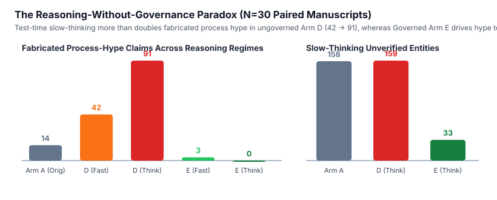

# Benchmark-50 Paper-Ready Tables & Figures (`Waves: wave1, wave2`, `30` Topics, `N=94` Manuscripts)

## Table 1: Multi-Host Paired Blind Evaluation (`Arm E` vs. `Arm D`)

| Upstream Host | $N$ | Qwen W/L/T | Qwen Net Win (95% CI) | Qwen $\Delta$Sum (95% CI) | DeepSeek Net | GLM Net | **3-Judge Majority W/L/T (`Net`, `$\Delta$Sum`)** |
| :--- | ---: | :---: | :---: | :---: | :---: | :---: | :---: |
| AI-Scientist-v2 | 30 | `18/6/6` | **`+0.400`** (`[+0.10, +0.67]`) | **`+1.85`** (`[+0.88, +2.80]`) | `+0.233` | `+0.500` | **`17/6/7`** (`+0.367`, `+1.59`) |
| EvoScientist (v2.1.2) | 30 | `12/8/10` | **`+0.133`** (`[-0.17, +0.43]`) | **`+0.72`** (`[+0.02, +1.42]`) | `-0.200` | `+0.000` | **`9/9/12`** (`+0.000`, `-0.03`) |
| Direct LLM | 30 | `11/9/10` | **`+0.067`** (`[-0.23, +0.37]`) | **`+0.70`** (`[-0.12, +1.53]`) | `-0.033` | `-0.033` | **`10/11/9`** (`-0.033`, `+0.01`) |
| E-DARA (Native) | 4 | `2/1/1` | **`+0.250`** (`[-0.50, +1.00]`) | **`-0.12`** (`[-3.12, +2.00]`) | `+0.000` | `+0.250` | **`2/1/1`** (`+0.250`, `+0.08`) |
| **External Agents Combined** | 60 | `30/14/16` | **`+0.267`** (`[+0.02, +0.50]`) | **`+1.28`** (`[+0.58, +1.95]`) | `+0.017` | `+0.250` | **`26/15/19`** (`+0.183`, `+0.78`) |
| **Overall All Hosts** | 94 | `43/24/27` | **`+0.206`** (`[+0.03, +0.37]`) | **`+1.06`** (`[+0.59, +1.52]`) | `-0.000` | `+0.158` | **`38/27/29`** (`+0.119`, `+0.51`) |

## Table 2: Deterministic Epistemic Hygiene & Guardrail Audit

| Deterministic Audit Metric | Arm A (Original) | Arm D (Unstructured R&R) | **Arm E (Governed Middleware)** | Relative Change (`E` vs `D`) |
| :--- | :---: | :---: | :---: | :---: |
| Native Host Schema Keys Preserved | `94/94` | — | **`94/94` (`100.0%`)** | Zero Schema Corruption |
| Unperformed Process-Hype Claims (`pre-registered`, etc.) | `59` | `187` | **`9`** | **`-95.2%`** |
| Unverified External Hallucinated Entities | `470` | `476` | **`144`** | **`-69.7%`** |
| Blocking Design Confounds Addressed | `21/51` | `27/51` (`52.9%`) | **`48/51` (`94.1%`)** | **`+41.2` pp** |
| Mean Full-Pipeline Cost (incl. 3-Judge Eval) | — | — | **`$0.179` / manuscript** | Total `$16.83` (`N=94`) |

## Table 3: Stratified 10-Domain & Dual-Track Breakdown

| Domain ID | Domain | $N$ | Qwen W/L/T | Qwen Net Win | Qwen $\Delta$Sum | Majority W/L/T | Majority $\Delta$Sum |
| :--- | :--- | ---: | :---: | ---: | ---: | :---: | ---: |
| `D01` | LLM Reasoning, RAG & Long-Context | 10 | `6/3/1` | `+0.361` | `+1.18` | `4/3/3` | `+0.74` |
| `D02` | Multimodal, Vision-Language & Speech | 9 | `5/2/2` | `+0.333` | `+1.17` | `3/3/3` | `+0.17` |
| `D03` | Diffusion, Flow & Generative Modeling | 9 | `4/1/4` | `+0.333` | `+2.22` | `4/1/4` | `+1.76` |
| `D04` | Reinforcement Learning, Robotics & Agents | 10 | `5/0/5` | `+0.500` | `+1.82` | `5/0/5` | `+1.56` |
| `D05` | Trustworthy AI, Safety & Fairness | 10 | `4/5/1` | `-0.083` | `+0.40` | `4/4/2` | `-0.03` |
| `D06` | Adaptation, Continual & OOD Robustness | 9 | `2/4/3` | `-0.222` | `+0.22` | `2/5/2` | `-0.30` |
| `D07` | Efficiency, Compression & ML Systems | 9 | `2/3/4` | `-0.111` | `+0.11` | `2/3/4` | `-0.28` |
| `D08` | Graph, Geometric & Temporal ML | 9 | `5/1/3` | `+0.444` | `+0.56` | `3/1/5` | `-0.04` |
| `D09` | Interpretability, Causality & Theory | 10 | `5/3/2` | `+0.167` | `+1.10` | `5/4/1` | `+0.71` |
| `D10` | AI for Science & Biomedicine | 9 | `5/2/2` | `+0.333` | `+1.83` | `6/3/0` | `+0.80` |
| — | **Track: Lit2Test** | 57 | `20/19/18` | `+0.018` | `+0.54` | `19/21/17` | `+0.08` |
| — | **Track: AlphaIdeaBench** | 37 | `23/5/9` | `+0.486` | `+1.84` | `19/6/12` | `+1.16` |

## Table 4: Cross-Backbone Generalization (`Qwen3.8-flash` Host + Editor, Role-Inverted Disjoint Judges)

| Stratum / Host (`Qwen3.8-flash` Backbone) | $N$ | DeepSeek Indep. W/L/T (`Net`) | GLM Indep. W/L/T (`Net`) | **Disjoint 2-Judge (`Net`)** | **3-Judge Majority W/L/T (`Net`, `$\Delta$Sum`)** |
| :--- | ---: | :---: | :---: | :---: | :---: |
| EvoScientist (v2.1.2) | 10 | `4/1/5` (`+0.300`) | `5/0/5` (`+0.500`) | **`7/1/2` (`+0.600`)** | **`7/1/2`** (`+0.600`, `+1.65`) |
| Direct LLM | 10 | `3/2/5` (`+0.100`) | `4/3/3` (`+0.100`) | **`5/4/1` (`+0.100`)** | **`4/2/4`** (`+0.200`, `+0.13`) |
| AI-Scientist-v2 | 10 | `3/5/2` (`-0.200`) | `4/5/1` (`-0.100`) | **`4/5/1` (`-0.100`)** | **`3/5/2`** (`-0.200`, `-1.97`) |
| **Overall All 3 Hosts (`Qwen3.8-flash`)** | 30 | `10/8/12` (`+0.067`) | `13/8/9` (`+0.167`) | **`16/10/4` (`+0.200`)** | **`14/8/8`** (`+0.200`, `-0.06`) |

- **Deterministic Guardrails (`Qwen3.8-flash`)**: Schema keys `30/30 (100%)`, Process hype `A=0 -> D=4 -> E=0 (-100%)`, Blocking confounds addressed `A=7/24 -> D=9/24 (37.5%) -> E=19/24 (79.2%)`.

## Table 5: Test-Time Reasoning (`Slow-Thinking`) & `8192`-Budget Sensitivity Ablation

| Regime / Stratum (`N=30` Paired Wave-1 Manuscripts) | Qwen Primary W/L/T (`Net`, `$\Delta$Sum`) | DeepSeek W/L/T (`Net`, `$\Delta$Sum`) | GLM W/L/T (`Net`, `$\Delta$Sum`) | **3-Judge Majority W/L/T (`Net [95% CI]`, `$\Delta$Sum [95% CI]`)** |
| :--- | :---: | :---: | :---: | :---: |
| `Fast Mode` (`thinking=off`, `4096` cap) | `15/7/8` (`+0.267`, `+1.50`) | `12/12/6` (`+0.000`, `+0.35`) | `12/7/11` (`+0.167`, `+0.83`) | `11/8/11` (`+0.100`, `+0.89`) |
| **`Slow-Thinking Mode` (`thinking=on`, `8192` cap)** | **`13/7/10`** (`+0.200`, `+1.07`) | **`10/4/16`** (`+0.200`, `+1.15`) | **`19/4/7`** (`+0.500`, `+1.48`) | **`13/3/14`** (**`+0.333`** `[+0.20, +0.47]`, **`+1.23`** `[+0.85, +1.64]`) |
| ↳ AI-Scientist-v2 (`Slow-Thinking`, $n=10$) | `4/2/4` (`+0.200`, `+1.40`) | `5/2/3` (`+0.300`, `+1.45`) | `8/1/1` (`+0.700`, `+2.60`) | **`6/1/3`** (`+0.500`, `+1.82`) |
| ↳ EvoScientist (v2.1.2) (`Slow-Thinking`, $n=10$) | `6/3/1` (`+0.300`, `+1.45`) | `3/2/5` (`+0.100`, `+0.85`) | `7/1/2` (`+0.600`, `+1.65`) | **`5/2/3`** (`+0.300`, `+1.32`) |
| ↳ Direct LLM (`Slow-Thinking`, $n=10$) | `3/2/5` (`+0.100`, `+0.35`) | `2/0/8` (`+0.200`, `+1.15`) | `4/2/4` (`+0.200`, `+0.20`) | **`2/0/8`** (`+0.200`, `+0.57`) |

- **The Reasoning-Without-Governance Paradox**: Enabling test-time slow-thinking in unconstrained `Arm D_think` **inflated fabricated process-hype claims from `A=14` & `D_fast=42` up to `D_think=91` (`+116.7%` over fast baseline)** while leaving unverified entities at `159` and addressing only `4/14` blocking confounds. Governed **`Arm E_think` reduced process hype `91 -> 0` (`-100.0%`)**, cut unverified entities **`159 -> 33` (`-79.2%`)**, and resolved **`12/14` (`85.7%`)** blocking confounds.
- **Initial Slow-Thinking Generation Probe (`n=10` Direct topics)**: Native slow-thinking during `Arm A` generation likewise increased process hype (`3 -> 8`) and unverified external entities (`45 -> 59`).

## Exported LaTeX Artifacts
- `table1_main_multihost.tex` (`booktabs` two-column main results table)
- `table2_domain_breakdown.tex` (`booktabs` 10-domain & track table)
- `table3_mechanism_ablation.tex` (`booktabs` deterministic audit table)
- `table4_cross_backbone.tex` (`booktabs` cross-backbone generalization table)
- `table5_thinking_ablation.tex` (`booktabs` 2×2 test-time reasoning scaling table)
