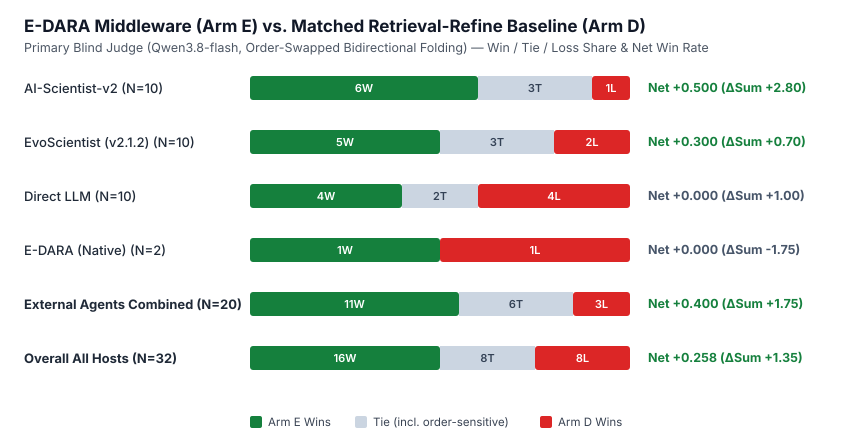
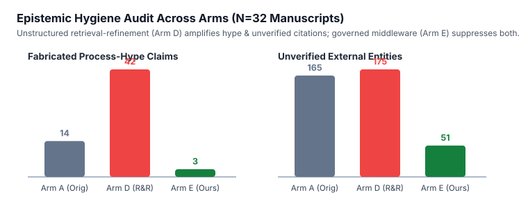
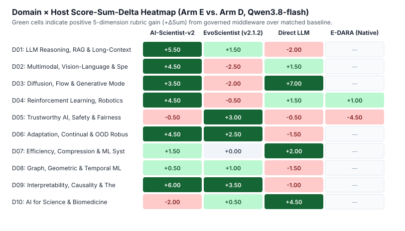

# Benchmark-50 Paper-Ready Tables & Figures (`Waves: wave1`, `10` Topics, `N=32` Manuscripts)

## Table 1: Multi-Host Paired Blind Evaluation (`Arm E` vs. `Arm D`)

| Upstream Host | $N$ | Qwen W/L/T | Qwen Net Win (95% CI) | Qwen $\Delta$Sum (95% CI) | DeepSeek Net | GLM Net | **3-Judge Majority W/L/T (`Net`, `$\Delta$Sum`)** |
| :--- | ---: | :---: | :---: | :---: | :---: | :---: | :---: |
| AI-Scientist-v2 | 10 | `6/1/3` | **`+0.500`** (`[+0.00, +0.90]`) | **`+2.80`** (`[+1.10, +4.35]`) | `+0.400` | `+0.700` | **`6/1/3`** (`+0.500`, `+2.55`) |
| EvoScientist (v2.1.2) | 10 | `5/2/3` | **`+0.300`** (`[-0.20, +0.80]`) | **`+0.70`** (`[-0.50, +1.85]`) | `-0.400` | `+0.000` | **`2/2/6`** (`+0.000`, `-0.17`) |
| Direct LLM | 10 | `4/4/2` | **`+0.000`** (`[-0.50, +0.60]`) | **`+1.00`** (`[-0.60, +2.85]`) | `+0.000` | `-0.200` | **`3/5/2`** (`-0.200`, `+0.30`) |
| E-DARA (Native) | 2 | `1/1/0` | **`+0.000`** (`[-1.00, +1.00]`) | **`-1.75`** (`[-4.50, +1.00]`) | `+0.000` | `-0.500` | **`1/1/0`** (`+0.000`, `-1.17`) |
| **External Agents Combined** | 20 | `11/3/6` | **`+0.400`** (`[+0.10, +0.70]`) | **`+1.75`** (`[+0.80, +2.77]`) | `+0.000` | `+0.350` | **`8/3/9`** (`+0.250`, `+1.19`) |
| **Overall All Hosts** | 32 | `16/8/8` | **`+0.258`** (`[+0.09, +0.42]`) | **`+1.35`** (`[+0.69, +1.98]`) | `-0.008` | `+0.125` | **`12/9/11`** (`+0.092`, `+0.78`) |

## Table 2: Deterministic Epistemic Hygiene & Guardrail Audit

| Deterministic Audit Metric | Arm A (Original) | Arm D (Unstructured R&R) | **Arm E (Governed Middleware)** | Relative Change (`E` vs `D`) |
| :--- | :---: | :---: | :---: | :---: |
| Native Host Schema Keys Preserved | `32/32` | — | **`32/32` (`100.0%`)** | Zero Schema Corruption |
| Unperformed Process-Hype Claims (`pre-registered`, etc.) | `14` | `42` | **`3`** | **`-92.9%`** |
| Unverified External Hallucinated Entities | `165` | `175` | **`51`** | **`-70.9%`** |
| Blocking Design Confounds Addressed | — | `0/0` | **`0/0`** | Discriminating Control Injected |
| Mean Full-Pipeline Cost (incl. 3-Judge Eval) | — | — | **`$0.171` / manuscript** | Total `$5.48` (`N=32`) |

## Table 3: Stratified 10-Domain & Dual-Track Breakdown

| Domain ID | Domain | $N$ | Qwen W/L/T | Qwen Net Win | Qwen $\Delta$Sum | Majority W/L/T | Majority $\Delta$Sum |
| :--- | :--- | ---: | :---: | ---: | ---: | :---: | ---: |
| `D01` | LLM Reasoning, RAG & Long-Context | 3 | `2/1/0` | `+0.333` | `+1.67` | `1/1/1` | `+0.94` |
| `D02` | Multimodal, Vision-Language & Speech | 3 | `2/1/0` | `+0.333` | `+1.17` | `1/1/1` | `+0.06` |
| `D03` | Diffusion, Flow & Generative Modeling | 3 | `2/1/0` | `+0.333` | `+2.83` | `2/0/1` | `+2.78` |
| `D04` | Reinforcement Learning, Robotics & Agents | 4 | `2/0/2` | `+0.500` | `+1.62` | `2/0/2` | `+1.58` |
| `D05` | Trustworthy AI, Safety & Fairness | 4 | `1/2/1` | `-0.250` | `-0.62` | `1/2/1` | `-0.54` |
| `D06` | Adaptation, Continual & OOD Robustness | 3 | `2/1/0` | `+0.333` | `+1.83` | `1/1/1` | `+1.50` |
| `D07` | Efficiency, Compression & ML Systems | 3 | `1/0/2` | `+0.333` | `+1.17` | `1/0/2` | `+0.72` |
| `D08` | Graph, Geometric & Temporal ML | 3 | `1/1/1` | `+0.000` | `+0.00` | `0/1/2` | `-1.11` |
| `D09` | Interpretability, Causality & Theory | 3 | `2/0/1` | `+0.667` | `+2.83` | `2/1/0` | `+2.00` |
| `D10` | AI for Science & Biomedicine | 3 | `1/1/1` | `+0.000` | `+1.00` | `1/2/0` | `-0.11` |
| — | **Track: Lit2Test** | 16 | `7/6/3` | `+0.083` | `+1.01` | `5/6/5` | `+0.50` |
| — | **Track: AlphaIdeaBench** | 16 | `9/2/5` | `+0.433` | `+1.69` | `7/3/6` | `+1.06` |

## Exported LaTeX Artifacts
- `table1_main_multihost.tex` (`booktabs` two-column main results table)
- `table2_domain_breakdown.tex` (`booktabs` 10-domain & track table)
- `table3_mechanism_ablation.tex` (`booktabs` deterministic audit table)
